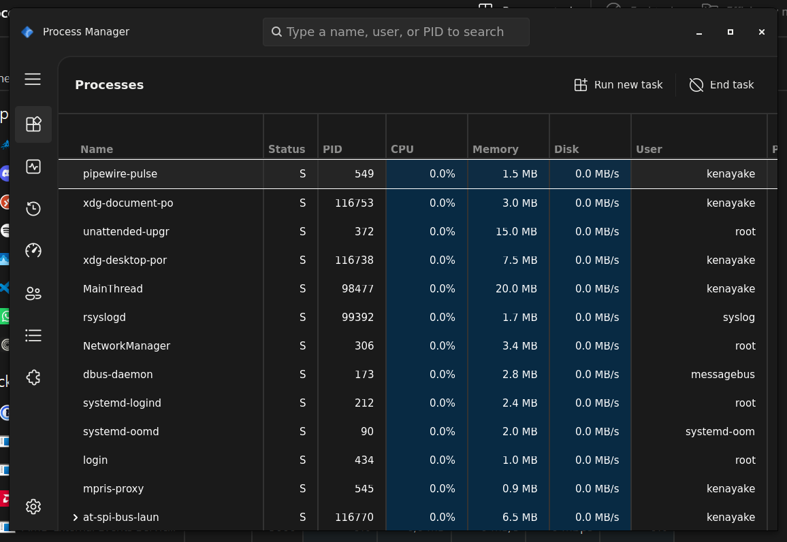
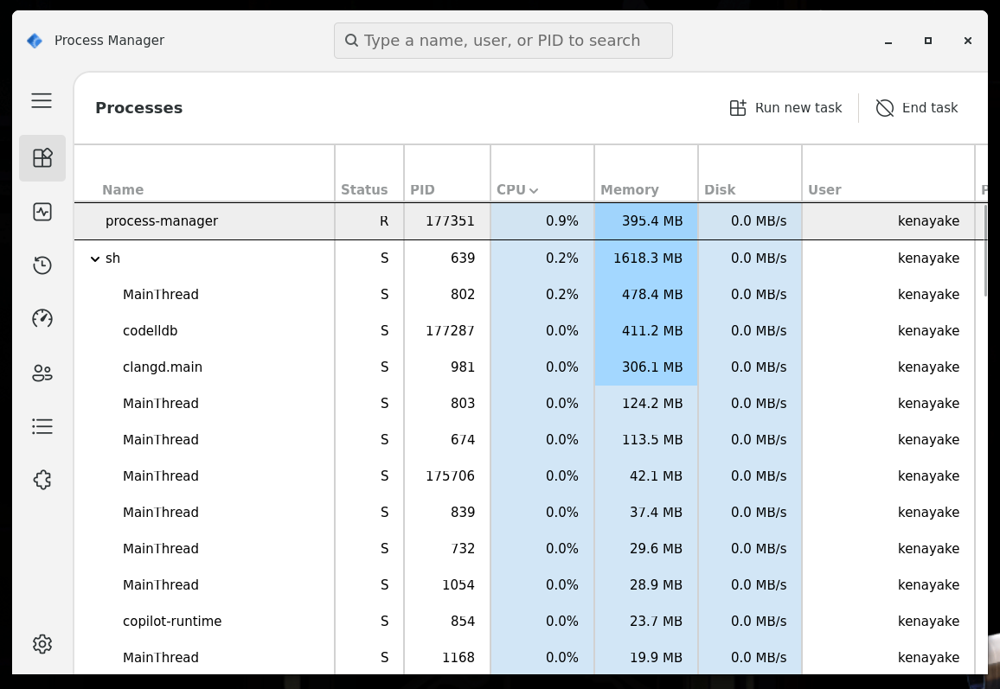
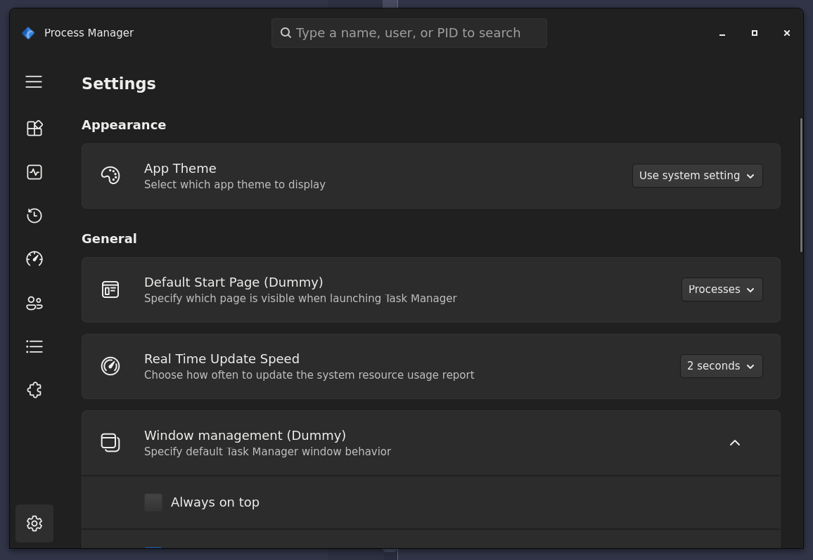

# C Process Manager for Linux

#### A mini project gone wrong

This GTK 4 program is a task manager clone initially made as a personal project to showcase my progress in learning C and low-level programming. It was planned as a simple GUI wrapping a service that reads the `/proc` filesystem, taking no more than a week or two. 

It did not, however, go according to plan and ended up taking the better part of almost 4 months to finish. I spent much more time writing GObject boilerplate and trying to understand the (sometimes outdated) documentation than writing the process scraper, which was my initial goal. As I have learned by now, choosing GTK as a beginner's C project was a bad idea. 


Also this was built entirely in WSL2, which has some bugs rendering with GTK and Wayland


## Features

- Processes tab, with several columns detailing each process
  - Grouped by PGID, expand to see process group children
  - Right-click context actions
  - Run new task and End task buttons
- Expandable sidebar
- Settings page with some settings available
- Search bar on top
- Really bad amateur code 


## Setup

If for some reason you want to check out this god-awful project, follow the steps below:

### Requirements
- GTK `>=4.20` (and its requirements)
- Meson and Ninja
- Not easily triggered

### Building
1. Clone the repository:  
   ```sh
   git clone https://github.com/kenayake/c-process-manager-linux.git
   ```
2. Navigate to the project directory:  
   ```sh
   cd c-process-manager-linux
   ```
3. Compile the program:
   ```sh
   meson compile -C builddir
   ```
4. Run:
   ```sh
   ./builddir/src/process-manager
   ```


## AI Use

At first I did not want to use AI, hence why some classes are not as complete as they should be. But at one point I understood that it would be unfeasible (for my sanity) if I didn't start using it at least for writing boilerplate. AI is used for:

- most of the boilerplate (creating classes and registering properties)
- debugging help
- other uses in commit messages


## (Not) Nice info

- CSS heavy so might not compatible with custom themes or kde
- lots of redundant code
- code quality gets lower as the project progressed and my sanity decreased

### Known Issues

- When a process becomes/stops becoming a group leader, the expander button does not appear/hide


## Screenshots





## License

This project is licensed under the MIT License.